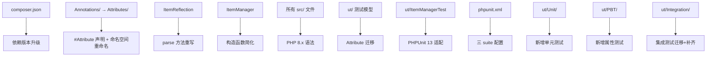

# Design Document

oasis/dynamodb-odm Release 2.0 现代化升级的技术设计。

---

## Overview

本设计覆盖 oasis/dynamodb-odm 从 PHP 7.1 / PHPUnit 5.7 到 PHP 8.5 / PHPUnit 13 的全面现代化升级。核心变更包括：

1. **依赖升级**：PHP ≥8.5、PHPUnit ^13.0、Symfony ^7.0、移除 `doctrine/annotations` 和 `doctrine/common`、新增 `giorgiosironi/eris` ^1.0
2. **Attribute 迁移**：四个注解类（`Field`、`Item`、`Index`、`PartitionedHashKey`）从 doctrine docblock 注解迁移到 PHP 8 原生 `#[Attribute]`，同时将目录从 `src/Annotations/` 重命名为 `src/Attributes/`，命名空间从 `Oasis\Mlib\ODM\Dynamodb\Annotations` 改为 `Oasis\Mlib\ODM\Dynamodb\Attributes`
3. **解析层重写**：`ItemReflection::parse()` 从 `Reader` 接口改为 `ReflectionClass::getAttributes()` / `ReflectionProperty::getAttributes()`
4. **构造函数简化**：`ItemManager::__construct()` 从 4 参数简化为 2 参数，移除 `$cacheDir` 和 `$isDev`
5. **PHP 8.x 语法升级**：typed properties、constructor promotion、readonly、match、`str_contains`/`str_starts_with`、移除 `setAccessible(true)`
6. **测试体系建设**：三层 test suite（unit / integration / pbt），mock Connection 隔离单元测试，Eris PBT 覆盖核心数据路径

### Gatekeep CR 决策体现

- **Q1**：抽象类与具体类同步升级，`protected` 方法签名一并收紧（`AbstractSchemaTool`、`AbstractDbConnection` 及其子类同步处理）
- **Q2**：PBT hydrate/dehydrate Round_Trip 数据生成覆盖 DynamoDB 全部数据类型（S/N/B/BOOL/NULL/L/M/SS/NS/BS）
- **Q3**：`ut/` 下新增 `Unit/`、`Integration/`、`PBT/` 子目录不违反 Non-Goals
- **Q4**：`DynamoDbSchemaTool` 通过 mock Connection 间接测试逻辑（表定义生成、GSI 差异计算等）

---

## Architecture

整体架构保持不变，变更集中在以下层：

```
变更前                              变更后
─────────────────────────────────────────────────────────
src/Annotations/ (doctrine)      →  src/Attributes/ (PHP 8 #[Attribute])
命名空间 ...\Annotations\*       →  命名空间 ...\Attributes\*
ItemReflection (Reader 接口)     →  ItemReflection (ReflectionAPI)
ItemManager (4 参数构造)          →  ItemManager (2 参数构造)
所有 src/ 文件 (PHP 7.1 语法)    →  所有 src/ 文件 (PHP 8.x 语法)
```

### 变更影响范围



---

## Components and Interfaces

### 1. Attribute 类迁移

**目录与命名空间重命名**：`src/Annotations/` → `src/Attributes/`，命名空间从 `Oasis\Mlib\ODM\Dynamodb\Annotations` 改为 `Oasis\Mlib\ODM\Dynamodb\Attributes`。所有引用处（`ItemReflection`、`ItemManager`、`ManagedItemState`、`DynamoDbSchemaTool`、`AbstractSchemaCommand`、测试模型类等）同步更新 `use` 语句。`composer.json` 的 `autoload.psr-4` 无需修改（`src/` 根映射已覆盖子目录）。

#### 1.1 `Field` 类

**变更前**（doctrine docblock）：

```php
use Doctrine\Common\Annotations\Annotation\Enum;
use Doctrine\Common\Annotations\Annotation\Target;

/**
 * @Annotation
 * @Target("PROPERTY")
 */
class Field
{
    public $name = null;
    public $type = 'string';  // @Enum({"string","number","binary","bool","null","list","map"})
    public $cas = self::CAS_DISABLED;  // @Enum({"disabled","enabled","timestamp"})
    public $gsiKey = false;
}
```

**变更后**（PHP 8 Attribute）：

```php
#[Attribute(Attribute::TARGET_PROPERTY)]
class Field
{
    public const CAS_DISABLED  = 'disabled';
    public const CAS_ENABLED   = 'enabled';
    public const CAS_TIMESTAMP = 'timestamp';

    public function __construct(
        public ?string $name = null,
        public string $type = 'string',
        public string $cas = self::CAS_DISABLED,
        public bool $gsiKey = false,
    ) {}
}
```

**设计决策**：
- 使用 constructor promotion 将属性声明和赋值合并
- `$name` 类型为 `?string`（可为 null，表示使用属性名作为字段名）
- `$type` 和 `$cas` 保持 string 类型，运行时验证由 `ItemReflection::parse()` 负责
- 移除所有 `Doctrine\Common\Annotations` 引用
- 命名空间从 `Oasis\Mlib\ODM\Dynamodb\Annotations` 改为 `Oasis\Mlib\ODM\Dynamodb\Attributes`

#### 1.2 `Item` 类

**变更后**：

```php
#[Attribute(Attribute::TARGET_CLASS)]
class Item
{
    public readonly string $table;
    public readonly Index $primaryIndex;
    /** @var Index[] */
    public readonly array $globalSecondaryIndices;
    /** @var Index[] */
    public readonly array $localSecondaryIndices;
    public readonly ?string $repository;
    public readonly bool $projected;

    public function __construct(
        string $table,
        array|Index $primaryIndex,
        array $globalSecondaryIndices = [],
        array $localSecondaryIndices = [],
        ?string $repository = null,
        bool $projected = false,
    ) {
        $this->table = $table;
        $this->primaryIndex = $primaryIndex instanceof Index
            ? $primaryIndex
            : new Index(...$primaryIndex);
        $this->globalSecondaryIndices = array_map(
            fn($idx) => $idx instanceof Index ? $idx : new Index(...$idx),
            $globalSecondaryIndices,
        );
        $this->localSecondaryIndices = array_map(
            fn($idx) => $idx instanceof Index ? $idx : new Index(...$idx),
            $localSecondaryIndices,
        );
        $this->repository = $repository;
        $this->projected = $projected;
    }
}
```

**设计决策**：
- 属性声明为 `readonly`，因为 `Item` 元数据在解析后不应被修改
- 构造函数保留对 `array|Index` 的兼容处理，使 `#[Item(primaryIndex: ['id'])]` 和 `#[Item(primaryIndex: new Index(hash: 'id'))]` 两种写法均可用
- `globalSecondaryIndices` 和 `localSecondaryIndices` 使用 `array_map` + 箭头函数统一转换
- 移除原有的 `foreach` + `switch` 逻辑，改用更简洁的函数式风格

#### 1.3 `Index` 类

**变更后**：

```php
// Index 不声明 #[Attribute]，因为它仅作为 Item 的嵌套参数使用，不直接标注在类或属性上
class Index
{
    public function __construct(
        public string $hash = '',
        public string $range = '',
        public string $name = '',
    ) {
        if ($this->hash === '') {
            throw new AnnotationParsingException(
                "Index must be constructed with a hash key"
            );
        }
    }

    // getKeys() 和 getDynamodbIndex() 方法保持不变
}
```

**设计决策**：
- `Index` 不声明 `#[Attribute]`，因为它不直接标注在类或属性上，而是作为 `Item` 构造函数的嵌套参数
- 使用 constructor promotion 简化属性声明
- 移除原有的 positional array 解析逻辑（`$values[0]`、`$values[1]`），因为 PHP 8 Attribute 使用命名参数
- 但保留从 `Item` 构造函数传入 plain array 时的兼容性（由 `Item` 构造函数负责转换）

**注意**：`Index` 构造函数的变更需要同步更新 `Item` 构造函数中的 array-to-Index 转换逻辑。当 `Item` 的 `primaryIndex` 或 GSI/LSI 以 plain array 形式传入时（如 `primaryIndex: ['gamecode']`），`Item` 构造函数使用 positional 展开（`new Index(...$arr)`）。这要求 plain array 的元素顺序与 `Index` 构造函数参数顺序一致（hash, range, name）。

#### 1.4 `PartitionedHashKey` 类

**变更后**：

```php
#[Attribute(Attribute::TARGET_PROPERTY)]
class PartitionedHashKey
{
    public function __construct(
        public string $hashField,
        public string $baseField,
        public int $size = 16,
    ) {}
}
```

**设计决策**：
- `$hashField` 和 `$baseField` 为必填参数（无默认值），替代原有的 `@Required()` 注解
- `$size` 默认值保持 16
- 使用 constructor promotion

### 2. `ItemReflection::parse()` 重写

**变更前**：

```php
public function parse(Reader $reader)
{
    $this->itemDefinition = $reader->getClassAnnotation($this->reflectionClass, Item::class);
    // ... $reader->getPropertyAnnotation(...)
}
```

**变更后**：

```php
public function parse(): void
{
    $this->reflectionClass = new ReflectionClass($this->itemClass);

    // 读取类级 Attribute
    $itemAttrs = $this->reflectionClass->getAttributes(Item::class);
    if (empty($itemAttrs)) {
        throw new NotAnnotatedException("Class {$this->itemClass} is not configured as an Item");
    }
    $this->itemDefinition = $itemAttrs[0]->newInstance();

    // 读取属性级 Attribute
    $this->propertyMapping      = [];
    $this->fieldDefinitions     = [];
    $this->reflectionProperties = [];
    $this->attributeTypes       = [];
    $this->casProperties        = [];
    $this->partitionedHashKeys  = [];

    foreach ($this->reflectionClass->getProperties() as $reflectionProperty) {
        if ($reflectionProperty->isStatic()) {
            continue;
        }
        $propertyName = $reflectionProperty->getName();
        $this->reflectionProperties[$propertyName] = $reflectionProperty;

        $fieldAttrs = $reflectionProperty->getAttributes(Field::class);
        if (empty($fieldAttrs)) {
            continue;
        }
        /** @var Field $field */
        $field = $fieldAttrs[0]->newInstance();
        $fieldName = $field->name ?? $propertyName;
        $this->propertyMapping[$fieldName]     = $propertyName;
        $this->fieldDefinitions[$propertyName] = $field;
        $this->attributeTypes[$fieldName]      = $field->type;
        if ($field->cas !== Field::CAS_DISABLED) {
            $this->casProperties[$propertyName] = $field->cas;
        }

        $phkAttrs = $reflectionProperty->getAttributes(PartitionedHashKey::class);
        if (!empty($phkAttrs)) {
            $this->partitionedHashKeys[$propertyName] = $phkAttrs[0]->newInstance();
        }
    }
}
```

**关键变更**：
- 方法签名从 `parse(Reader $reader)` 变为 `parse(): void`（无参数，添加 void 返回类型）
- 使用 `ReflectionClass::getAttributes()` 和 `ReflectionProperty::getAttributes()` 替代 `Reader` 接口
- 通过 `$attr->newInstance()` 实例化 Attribute 对象
- 逻辑流程与原版保持一致，仅替换数据来源

### 3. `ItemManager` 构造函数简化

**变更前**：

```php
public function __construct($dbCnn, $defaultTablePrefix, $cacheDir, $isDev = true)
{
    // ... Connection 或 array 处理 ...
    AnnotationRegistry::registerLoader([$this, 'loadAnnotationClass']);
    $this->reader = new CachedReader(
        new AnnotationReader(),
        new FilesystemCache($cacheDir),
        $isDev
    );
}
```

**变更后**：

```php
public function __construct(
    array|Connection $dbCnn,
    private readonly string $defaultTablePrefix = '',
) {
    if ($dbCnn instanceof Connection) {
        $this->dbConnection = $dbCnn;
    } else {
        $this->databaseConfig = $dbCnn;
    }
}
```

**关联变更**：
- 移除 `$reader` 属性和 `getReader()` 方法
- 移除 `loadAnnotationClass()` 方法
- `getItemReflection()` 调用 `$reflection->parse()` 时不再传递 `$reader` 参数
- 移除所有 `Doctrine\Common\Annotations` 和 `Doctrine\Common\Cache` 的 import

### 4. PHP 8.x 语法升级策略

以下为逐文件的升级分析：

#### 4.1 `src/Attributes/Field.php`（原 `src/Annotations/Field.php`）

| 升级项 | 说明 |
|--------|------|
| 目录/命名空间 | `Annotations` → `Attributes` |
| `#[Attribute]` | 添加 `#[Attribute(Attribute::TARGET_PROPERTY)]` |
| Constructor promotion | 所有属性通过构造函数参数声明 |
| 移除 doctrine import | 移除 `Enum`、`Target` 引用 |

#### 4.2 `src/Attributes/Item.php`（原 `src/Annotations/Item.php`）

| 升级项 | 说明 |
|--------|------|
| 目录/命名空间 | `Annotations` → `Attributes` |
| `#[Attribute]` | 添加 `#[Attribute(Attribute::TARGET_CLASS)]` |
| `readonly` | 所有属性声明为 readonly |
| 移除 doctrine import | 移除 `Required`、`Target` 引用 |
| 箭头函数 | GSI/LSI 转换使用 `array_map` + `fn()` |

#### 4.3 `src/Attributes/Index.php`（原 `src/Annotations/Index.php`）

| 升级项 | 说明 |
|--------|------|
| 目录/命名空间 | `Annotations` → `Attributes` |
| Constructor promotion | `$hash`、`$range`、`$name` |
| 移除 doctrine import | 移除 `Required` 引用 |
| 简化构造逻辑 | 移除 positional array 解析，仅保留命名参数 |

#### 4.4 `src/Attributes/PartitionedHashKey.php`（原 `src/Annotations/PartitionedHashKey.php`）

| 升级项 | 说明 |
|--------|------|
| 目录/命名空间 | `Annotations` → `Attributes` |
| `#[Attribute]` | 添加 `#[Attribute(Attribute::TARGET_PROPERTY)]` |
| Constructor promotion | 所有属性通过构造函数参数声明 |
| 移除 doctrine import | 移除 `Required` 引用 |

#### 4.5 `src/ItemReflection.php`

| 升级项 | 说明 |
|--------|------|
| Typed properties | `$itemClass: string`、`$reflectionClass: ?ReflectionClass`、`$itemDefinition: ?Item` 等 |
| `parse()` 重写 | 无参数，使用 ReflectionAPI |
| 移除 `setAccessible()` | `getPropertyValue()` 和 `updateProperty()` 中移除 `setAccessible(true)` 调用 |
| 移除 doctrine import | 移除 `Reader` 引用 |
| 更新 import | `Annotations\*` → `Attributes\*` |
| 返回类型声明 | 所有方法添加返回类型 |

#### 4.6 `src/ItemManager.php`

| 升级项 | 说明 |
|--------|------|
| 构造函数简化 | 2 参数 + constructor promotion |
| Typed properties | `$possibleItemClasses: array`、`$skipCheckAndSet: bool` 等 |
| 移除 doctrine 相关 | 移除 `$reader`、`getReader()`、`loadAnnotationClass()`、所有 doctrine import |
| 返回类型声明 | 所有方法添加返回类型 |
| Union type | `$dbCnn: array\|Connection` |

#### 4.7 `src/ItemRepository.php`

| 升级项 | 说明 |
|--------|------|
| Typed properties | `$itemManager: ItemManager`、`$itemReflection: ItemReflection`、`$dbConnection: Connection` 等 |
| Constructor promotion | `$itemReflection` 和 `$itemManager` |
| 返回类型声明 | 所有方法添加返回类型 |

#### 4.8 `src/ManagedItemState.php`

| 升级项 | 说明 |
|--------|------|
| Typed properties | `$itemReflection: ItemReflection`、`$item: object`、`$originalData: array`、`$state: int` |
| Constructor promotion | `$itemReflection`、`$item`、`$originalData` |
| `match` 表达式 | `isDataEqual()` 中的 `switch(true)` 可用 `match` 替代 |
| 更新 import | `Annotations\Field` → `Attributes\Field` |
| 返回类型声明 | 所有方法添加返回类型 |

#### 4.9 `src/DBAL/Drivers/AbstractDbConnection.php`

| 升级项 | 说明 |
|--------|------|
| Typed properties | `$dbConfig: array`、`$tableName: string`、`$attributeTypes: array`、`$itemReflection: ?ItemReflection` |
| 返回类型声明 | 所有方法添加返回类型 |
| 注意 | `__construct($dbConfig)` 签名不变（`Connection` 接口约束） |

#### 4.10 `src/DBAL/Drivers/DynamoDbConnection.php`

| 升级项 | 说明 |
|--------|------|
| Typed properties | `$dynamodbTable: ?DynamoDbTable` |
| 返回类型声明 | 所有方法添加返回类型 |

#### 4.11 `src/DBAL/Drivers/Connection.php`

| 升级项 | 说明 |
|--------|------|
| 返回类型声明 | 所有方法添加返回类型（`__construct` 除外） |
| 注意 | `__construct($dbConfig)` 不做改变（Non-Goal） |

#### 4.12 `src/DBAL/Schema/AbstractSchemaTool.php`

| 升级项 | 说明 |
|--------|------|
| Typed properties | 所有属性添加类型 |
| Constructor promotion | `$itemManager`、`$classReflections`、`$outputFunction` |
| 返回类型声明 | 所有方法添加返回类型 |
| `protected` 方法签名收紧 | 与子类 `DynamoDbSchemaTool` 同步（CR Q1 决策） |

#### 4.13 `src/DBAL/Schema/DynamoDbSchemaTool.php`

| 升级项 | 说明 |
|--------|------|
| 返回类型声明 | `createSchema(): void`、`updateSchema(): void`、`dropSchema(): void` |
| 更新 import | `Annotations\Index` → `Attributes\Index` |
| `str_contains` | 如有 `strpos` 模式则替换 |

#### 4.14 `src/Console/Commands/AbstractSchemaCommand.php`

| 升级项 | 说明 |
|--------|------|
| Typed properties | `$itemManager: ?ItemManager` |
| 返回类型声明 | `withItemManager(): static`、`getItemManager(): ItemManager`、`getManagedItemClasses(): array` |

#### 4.15 `src/Console/Commands/CreateSchemaCommand.php`、`UpdateSchemaCommand.php`、`DropSchemaCommand.php`

| 升级项 | 说明 |
|--------|------|
| 返回类型声明 | `configure(): void`、`execute(): int`（Symfony 7 要求返回 int） |

#### 4.16 `src/Console/ConsoleHelper.php`

| 升级项 | 说明 |
|--------|------|
| Constructor promotion | `$itemManager` |
| 返回类型声明 | 所有方法添加返回类型 |

#### 4.17 异常类

所有异常类（`ODMException`、`DataConsistencyException`、`AnnotationParsingException`、`NotAnnotatedException`、`UnderlyingDatabaseException`）结构简单，无需语法升级。`DataConsistencyException` 当前继承 `RuntimeException` 而非 `ODMException`，保持不变以维持 API 兼容。

### 5. 测试模型 Attribute 迁移

`ut/` 下的五个测试模型类需要从 docblock 注解迁移到 PHP 8 原生 Attribute，并将 import 从 `Oasis\Mlib\ODM\Dynamodb\Annotations\*` 改为 `Oasis\Mlib\ODM\Dynamodb\Attributes\*`。以 `User` 类为例：

**变更前**：

```php
/**
 * @Item(
 *     table="users",
 *     primaryIndex=@Index(hash="id"),
 *     globalSecondaryIndices={
 *      {"hometown", "age"},
 *      {"hometown", "wage"},
 *      @Index(hash="hometownPartition", range="age", name="home-age-gsi")
 *     }
 * )
 */
class User
{
    /** @Field(type="number", name="uid") */
    protected $id = 0;
    /** @Field(type="string", cas="enabled") */
    protected $name;
    // ...
}
```

**变更后**：

```php
use Oasis\Mlib\ODM\Dynamodb\Attributes\Field;
use Oasis\Mlib\ODM\Dynamodb\Attributes\Index;
use Oasis\Mlib\ODM\Dynamodb\Attributes\Item;

#[Item(
    table: 'users',
    primaryIndex: new Index(hash: 'id'),
    globalSecondaryIndices: [
        new Index(hash: 'hometown', range: 'age'),
        new Index(hash: 'hometown', range: 'wage'),
        new Index(hash: 'hometownPartition', range: 'age', name: 'home-age-gsi'),
    ],
)]
class User
{
    #[Field(type: 'number', name: 'uid')]
    protected int $id = 0;
    #[Field(type: 'string', cas: Field::CAS_ENABLED)]
    protected ?string $name = null;
    // ...
}
```

其余四个模型类（`Game`、`ConsoleGame`、`BasicGameInfo`、`CasDemoUser`）按相同模式迁移。

### 6. PHPUnit 13 适配

#### 6.1 `ItemManagerTest` 适配

- `PHPUnit_Framework_TestCase` → `PHPUnit\Framework\TestCase`
- `setUp()` 添加 `: void` 返回类型
- 构造 `ItemManager` 时移除 `$cacheDir` 和 `$isDev` 参数
- 迁移到 `ut/Integration/ItemManagerTest.php`

#### 6.2 `phpunit.xml` 更新

```xml
<?xml version="1.0" encoding="UTF-8"?>
<phpunit xmlns:xsi="http://www.w3.org/2001/XMLSchema-instance"
         xsi:noNamespaceSchemaLocation="vendor/phpunit/phpunit/phpunit.xsd"
         bootstrap="ut/bootstrap.php"
         colors="true"
         cacheDirectory=".phpunit.cache">
    <testsuites>
        <testsuite name="unit">
            <directory>ut/Unit</directory>
        </testsuite>
        <testsuite name="integration">
            <directory>ut/Integration</directory>
        </testsuite>
        <testsuite name="pbt">
            <directory>ut/PBT</directory>
        </testsuite>
    </testsuites>
    <source>
        <include>
            <directory>src</directory>
        </include>
    </source>
</phpunit>
```

### 7. 测试目录结构

```
ut/
├── Unit/                          # 隔离单元测试
│   ├── Attributes/
│   │   ├── FieldTest.php
│   │   ├── ItemTest.php
│   │   ├── IndexTest.php
│   │   └── PartitionedHashKeyTest.php
│   ├── Console/
│   │   ├── ConsoleHelperTest.php
│   │   └── Commands/
│   │       ├── CreateSchemaCommandTest.php
│   │       ├── UpdateSchemaCommandTest.php
│   │       └── DropSchemaCommandTest.php
│   ├── Exceptions/
│   │   └── ExceptionHierarchyTest.php
│   ├── ItemReflectionTest.php
│   ├── ManagedItemStateTest.php
│   ├── ItemRepositoryTest.php
│   └── ItemManagerTest.php
├── Integration/                   # 集成测试（需真实 DynamoDB）
│   └── ItemManagerTest.php        # 从 ut/ItemManagerTest.php 迁移
├── PBT/                           # 属性测试
│   ├── HydrateDehydrateRoundTripTest.php
│   ├── DirtyDataIdempotenceTest.php
│   ├── CasCheckConditionTest.php
│   ├── PartitionedHashKeyTest.php
│   ├── IndexKeysConsistencyTest.php
│   └── PartitionedValuesTest.php
├── User.php                       # 测试模型（保持位置不变）
├── Game.php
├── ConsoleGame.php
├── BasicGameInfo.php
├── CasDemoUser.php
├── UTConfig.php
├── bootstrap.php
└── tpl.ut.yml
```

### 8. 单元测试 Mock 策略

所有单元测试通过 mock `Connection` 接口隔离 DynamoDB 依赖：

```php
$mockConnection = $this->createMock(Connection::class);
$mockConnection->method('get')->willReturn([...]);
$mockConnection->method('set')->willReturn(true);
// ...
```

对于 `ItemManager` 单元测试，构造时传入 mock `Connection` 实例：

```php
$im = new ItemManager($mockConnection, 'test_');
```

对于 `DynamoDbSchemaTool` 单元测试（CR Q4 决策），通过 mock `Connection` 的 `getSchemaTool()` 方法间接测试 SchemaTool 的逻辑。具体来说：
- 测试 `AbstractSchemaCommand::getManagedItemClasses()` 的类过滤逻辑
- 测试 `ConsoleHelper` 的命令注册
- SchemaTool 的核心逻辑（表定义生成、GSI 差异计算）在集成测试中覆盖

---

## Data Models

本次升级不改变数据模型。DynamoDB 中存储的数据格式保持不变。

### Attribute 元数据模型

Attribute 类的属性即为元数据模型，升级前后语义不变：

| Attribute | 属性 | 类型 | 默认值 | 说明 |
|-----------|------|------|--------|------|
| `Field` | `name` | `?string` | `null` | DynamoDB attribute 名（null 时使用属性名） |
| `Field` | `type` | `string` | `'string'` | 数据类型 |
| `Field` | `cas` | `string` | `'disabled'` | CAS 策略 |
| `Field` | `gsiKey` | `bool` | `false` | 是否为 GSI key |
| `Item` | `table` | `string` | （必填） | 表名 |
| `Item` | `primaryIndex` | `Index` | （必填） | 主键索引 |
| `Item` | `globalSecondaryIndices` | `Index[]` | `[]` | GSI 列表 |
| `Item` | `localSecondaryIndices` | `Index[]` | `[]` | LSI 列表 |
| `Item` | `repository` | `?string` | `null` | 自定义 Repository 类 |
| `Item` | `projected` | `bool` | `false` | 是否为投影只读 |
| `Index` | `hash` | `string` | （必填） | Hash key 属性名 |
| `Index` | `range` | `string` | `''` | Range key 属性名 |
| `Index` | `name` | `string` | `''` | 索引名 |
| `PartitionedHashKey` | `hashField` | `string` | （必填） | 哈希源属性名 |
| `PartitionedHashKey` | `baseField` | `string` | （必填） | 基础值属性名 |
| `PartitionedHashKey` | `size` | `int` | `16` | 分区数 |

### `composer.json` 依赖变更

| 包 | 变更前 | 变更后 |
|----|--------|--------|
| `php` | `>=7.1` | `>=8.5` |
| `doctrine/annotations` | `^1.4` | **移除** |
| `doctrine/common` | `^2.7` | **移除** |
| `symfony/console` | `^4.4` | `^7.0` |
| `symfony/finder` | `^4.4` | `^7.0` |
| `oasis/aws-wrappers` | `^2.10` | 最新兼容版本 |
| `oasis/logging` | `^1.0` | 最新兼容版本 |
| `phpunit/phpunit` | `^5.7` | `^13.0` |
| `giorgiosironi/eris` | — | `^1.0`（新增 dev） |

---

## Correctness Properties

*A property is a characteristic or behavior that should hold true across all valid executions of a system — essentially, a formal statement about what the system should do. Properties serve as the bridge between human-readable specifications and machine-verifiable correctness guarantees.*

### Property 1: Hydrate/Dehydrate Round-Trip

*For any* valid field data array（覆盖 DynamoDB 全部数据类型 S/N/B/BOOL/NULL/L/M/SS/NS/BS），将其 hydrate 到对象再 dehydrate 回数组后，应产生与原始数据等价的数组（考虑 DynamoDB 的 null/空字符串等价性：null 值在 string 类型字段上 hydrate 后变为 `""`，dehydrate 后保持 `""`）。

**Validates: Requirements 11.2**

### Property 2: Dirty Data Detection Idempotence

*For any* valid field data数组，用该数据 hydrate 一个对象并以相同数据初始化 `ManagedItemState`，在不修改对象的情况下，`hasDirtyData()` 应返回 `false`。

**Validates: Requirements 11.3**

### Property 3: CAS Check Condition Invariant

*For any* 包含 CAS-enabled 字段的有效原始数据，`ManagedItemState::getCheckConditionData()` 应返回一个数组，其中每个 CAS 字段的值等于原始数据中对应字段的值。

**Validates: Requirements 11.4**

### Property 4: PartitionedHashKey Computation Determinism

*For any* 有效的 base value 和 hash source 字符串，使用相同输入两次计算 PartitionedHashKey 应产生完全相同的结果。

**Validates: Requirements 11.5**

### Property 5: Index Keys Consistency

*For any* 有效的 hash key 字符串和可选的 range key 字符串，`Index::getKeys()` 应返回一个数组，当 range 非空时包含恰好 2 个元素（hash 和 range），当 range 为空时包含恰好 1 个元素（hash）。

**Validates: Requirements 11.6**

### Property 6: Partitioned Values Output Size

*For any* 有效的 partition size（正整数）和 base value 字符串，`ItemReflection::getAllPartitionedValues()` 应返回恰好 `size` 个元素的数组。

**Validates: Requirements 11.7**

---

## Error Handling

### 异常体系（保持不变）

| 异常类 | 继承 | 触发场景 |
|--------|------|----------|
| `ODMException` | `RuntimeException` | 通用 ODM 错误 |
| `DataConsistencyException` | `RuntimeException` | CAS 冲突 |
| `AnnotationParsingException` | `ODMException` | Attribute 解析错误 |
| `NotAnnotatedException` | `ODMException` | 类未标注 `#[Item]` |
| `UnderlyingDatabaseException` | `ODMException` | 底层数据库异常结果 |

### 新增的错误路径

1. **`Index` 构造函数**：当 `$hash` 为空字符串时抛出 `AnnotationParsingException`
2. **`ItemReflection::parse()`**：当类缺少 `#[Item]` Attribute 时抛出 `NotAnnotatedException`（与原行为一致）
3. **`Item` 构造函数**：当 `primaryIndex` 为空数组或无效格式时，由 `Index` 构造函数抛出异常

### 错误处理策略

- 所有异常类保持现有继承关系不变
- `DataConsistencyException` 继续直接继承 `RuntimeException`（而非 `ODMException`），保持 API 兼容
- Attribute 参数类型错误（如 `Field::type` 传入非法值）不在 Attribute 构造函数中验证，由使用方（`ItemReflection`、`DynamoDbConnection`）在运行时处理

---

## Testing Strategy

### 升级阶段策略

升级采用**先加固再迁移**的策略，分两个阶段：

1. **Phase 0 — 旧环境测试加固**：在 PHP 7.4 + PHPUnit 5.7 + doctrine/annotations 环境下，补齐隔离单元测试（mock Connection），建立覆盖率基线。使用 `php74 vendor/bin/phpunit` 运行。此阶段的测试使用旧 API（`Reader` 参数、4 参数构造函数、docblock 注解），确保升级前的行为被充分覆盖。
2. **Phase 1 — 升级与迁移**：在测试保护下执行依赖升级、Attribute 迁移、语法升级。每步升级后运行测试验证无回归。测试代码随源码同步适配（PHPUnit 13 API、新命名空间、新构造函数签名）。

这种顺序确保升级过程中有测试网兜着，回归风险可控。

### 测试分层

| 层 | 目录 | 运行方式 | 依赖 |
|----|------|----------|------|
| Unit | `ut/Unit/` | `vendor/bin/phpunit --testsuite unit` | 无外部依赖，mock Connection |
| PBT | `ut/PBT/` | `vendor/bin/phpunit --testsuite pbt` | 无外部依赖，mock Connection |
| Integration | `ut/Integration/` | `vendor/bin/phpunit --testsuite integration` | 真实 DynamoDB 环境 |

### 单元测试策略

通过 mock `Connection` 接口隔离所有外部依赖。覆盖范围：

| 测试目标 | 测试重点 |
|----------|----------|
| `Field` / `Item` / `Index` / `PartitionedHashKey` | 构造参数、默认值、属性访问 |
| `ItemReflection` | Attribute 解析、hydrate/dehydrate、属性读写、主键提取、字段映射、PartitionedHashKey 值生成 |
| `ManagedItemState` | 脏数据检测、CAS 时间戳更新、PartitionedHashKey 更新、check condition 生成、状态转换 |
| `ItemRepository` | persist/get/remove/flush/detach/refresh、query 字段解析、batch 操作 |
| `ItemManager` | Connection 构造、array 构造、命名空间扫描、repository 缓存、操作委托 |
| Console Commands | 命令配置、managed item class 解析 |
| `ConsoleHelper` | 命令注册 |
| 异常类 | 继承关系验证 |

### PBT 策略

使用 `giorgiosironi/eris` ^1.0，每个 property test 最少 100 次迭代。

| Property | 测试文件 | 生成器 |
|----------|----------|--------|
| Property 1: Round-Trip | `HydrateDehydrateRoundTripTest.php` | 生成覆盖 DynamoDB 全部类型（S/N/B/BOOL/NULL/L/M/SS/NS/BS）的 field data 数组 |
| Property 2: Idempotence | `DirtyDataIdempotenceTest.php` | 复用 Property 1 的数据生成器 |
| Property 3: CAS Invariant | `CasCheckConditionTest.php` | 生成包含 CAS 字段的原始数据 |
| Property 4: Determinism | `PartitionedHashKeyTest.php` | 生成随机字符串作为 base value 和 hash source |
| Property 5: Keys Consistency | `IndexKeysConsistencyTest.php` | 生成随机 hash/range 字符串 |
| Property 6: Output Size | `PartitionedValuesTest.php` | 生成随机正整数（partition size）和字符串（base value） |

**PBT 数据生成范围**（CR Q2 决策）：

hydrate/dehydrate Round-Trip 测试的数据生成器需覆盖 DynamoDB 全部数据类型：

| DynamoDB 类型 | Eris 生成器 | 说明 |
|---------------|-------------|------|
| S (String) | `Generator\string()` | 随机字符串 |
| N (Number) | `Generator\int()`, `Generator\float()` | 整数和浮点数 |
| B (Binary) | `Generator\string()` | 随机二进制数据 |
| BOOL | `Generator\bool()` | true/false |
| NULL | 常量 `null` | null 值 |
| L (List) | `Generator\seq()` | 随机列表 |
| M (Map) | `Generator\associative()` | 随机映射 |
| SS (String Set) | `Generator\set(Generator\string())` | 字符串集合 |
| NS (Number Set) | `Generator\set(Generator\int())` | 数字集合 |
| BS (Binary Set) | `Generator\set(Generator\string())` | 二进制集合 |

每个 property test 必须包含注释引用对应的 design property：

```php
// Feature: release-2.0, Property 1: Hydrate/Dehydrate Round-Trip
```

### 集成测试策略

基于真实 DynamoDB 环境，覆盖：

| 测试场景 | 说明 |
|----------|------|
| CRUD 生命周期 | create → read → update → delete |
| Query + GSI | 使用 GSI 进行条件查询 |
| Scan + 并行 Scan | 全表扫描和并行扫描 |
| BatchGet | 批量获取 |
| CAS 冲突 | 两个 ItemManager 并发修改同一 item |
| CAS 时间戳 | 自动更新时间戳 |
| PartitionedHashKey MultiQuery | 基于分区键的多查询 |
| Projected Item | 只读投影 item |
| Schema 工具 | create/update/drop 表 |

### 覆盖率目标

| 指标 | 目标 |
|------|------|
| Unit + PBT 行覆盖率 | ≥ 85% |
| Integration 行覆盖率 | ≥ 75% |
| 覆盖率驱动 | Xdebug 或 PCOV |

---

## Impact Analysis

### 受影响的 state 文档

| 文件 | 受影响 Section | 变更内容 |
|------|---------------|----------|
| `docs/state/architecture.md` | 分层结构 | `Annotations` → `Attributes`，描述更新为 PHP 8 原生 Attribute |
| `docs/state/architecture.md` | 核心类职责 — `ItemManager` | 构造函数描述从 4 参数改为 2 参数，移除 `$cacheDir`/`$isDev` 和注解缓存相关描述 |
| `docs/state/architecture.md` | 核心类职责 — `ItemReflection` | 解析方式从 `@Item`/`@Field`/`@PartitionedHashKey` 注解改为 `#[Item]`/`#[Field]`/`#[PartitionedHashKey]` Attribute |
| `docs/state/architecture.md` | 注解体系 | 整个 section 重写：注解 → Attribute，`@` 语法 → `#[]` 语法 |
| `docs/state/architecture.md` | DBAL 抽象 | `ItemManager` 构造时不再接受 `$cacheDir`/`$isDev` |
| `PROJECT.md` | 技术栈 / 依赖 / 测试 | PHP ≥8.5、PHPUnit ^13.0、Symfony ^7.0、移除 doctrine、新增 eris、三 suite 命令 |

### 现有行为变化

| 变更点 | 变更前 | 变更后 | 影响范围 |
|--------|--------|--------|----------|
| `ItemManager` 构造签名 | 4 参数（`$dbCnn`, `$prefix`, `$cacheDir`, `$isDev`） | 2 参数（`$dbCnn`, `$prefix`） | 所有构造 `ItemManager` 的调用方（`ut/ItemManagerTest.php`、`bin/oasis-dynamodb-odm`、外部使用者） |
| `ItemReflection::parse()` 签名 | `parse(Reader $reader)` | `parse(): void` | 仅 `ItemManager::getItemReflection()` 内部调用，非公共 API |
| 命名空间 | `Oasis\Mlib\ODM\Dynamodb\Annotations\*` | `Oasis\Mlib\ODM\Dynamodb\Attributes\*` | 所有 `use` 该命名空间的文件（src 内部 + 外部使用者） |
| 目录 | `src/Annotations/` | `src/Attributes/` | autoload 不受影响（PSR-4 根映射） |
| `ItemManager::getReader()` | 返回 `AnnotationReader` | **移除** | 外部如有调用将 break |
| `ItemManager::loadAnnotationClass()` | 存在 | **移除** | 外部如有调用将 break |

### 数据模型变更

不涉及。DynamoDB 中存储的数据格式保持不变，Attribute 元数据仅影响 PHP 代码层面的声明方式。

### 外部系统交互变化

不涉及。与 DynamoDB 的交互方式不变（通过 `oasis/aws-wrappers`），仅升级版本约束。

### 配置项变更

| 配置项 | 变更 |
|--------|------|
| `composer.json` | 依赖版本全面升级（见 Data Models 的 composer.json 变更表） |
| `phpunit.xml` | 升级到 PHPUnit 13 schema，新增三个 test suite，新增 `<source>` 覆盖率配置 |
| `ItemManager` 构造参数 `$cacheDir` | **移除**（不再需要注解缓存目录） |
| `ItemManager` 构造参数 `$isDev` | **移除**（不再需要开发模式标志） |

### 文档更新清单（Requirement 14）

| 文件 | 更新内容 |
|------|----------|
| `PROJECT.md` | PHP ≥8.5、PHPUnit ^13.0、`symfony/console` ^7.0、`symfony/finder` ^7.0、移除 `doctrine/annotations` 和 `doctrine/common`、新增 `giorgiosironi/eris` ^1.0（dev）、三 suite 测试命令 |
| `docs/state/architecture.md` | 注解体系 → Attribute 体系（含命名空间变更）、`ItemManager` 构造函数简化为 2 参数、`ItemReflection` 解析方式从 Reader 改为 ReflectionAPI |

---

## Socratic Review

### Q1: 设计是否覆盖了 requirements 中的所有 14 条 Requirement？

**A:** 是。
- Requirement 1-2（版本/依赖升级）→ Data Models 的 composer.json 变更表
- Requirement 3（Attribute 迁移）→ Components 1.1-1.4
- Requirement 4（ItemReflection 解析迁移）→ Components 2
- Requirement 5（ItemManager 简化）→ Components 3
- Requirement 6（PHP 8.x 语法升级）→ Components 4.1-4.17
- Requirement 7（测试模型迁移）→ Components 5
- Requirement 8（PHPUnit 13 适配）→ Components 6.1
- Requirement 9（phpunit.xml 配置）→ Components 6.2
- Requirement 10（单元测试）→ Testing Strategy 单元测试策略
- Requirement 11（PBT）→ Correctness Properties + Testing Strategy PBT 策略
- Requirement 12（覆盖率）→ Testing Strategy 覆盖率目标
- Requirement 13（集成测试）→ Testing Strategy 集成测试策略
- Requirement 14（文档更新）→ Impact Analysis 的文档更新清单

### Q2: Gatekeep CR 的四个决策是否在设计中体现？

**A:** 是。
- Q1（抽象类同步升级）→ Components 4.12 明确 `AbstractSchemaTool` 的 `protected` 方法签名收紧与子类同步
- Q2（覆盖全部 DynamoDB 类型）→ Testing Strategy PBT 数据生成范围表
- Q3（`ut/` 下新增子目录）→ Components 7 测试目录结构
- Q4（mock Connection 间接测试 SchemaTool）→ Components 8 单元测试 Mock 策略

### Q3: Attribute 迁移设计是否保持了向后兼容？

**A:** 命名空间从 `Annotations` 改为 `Attributes` 是一个 breaking change（外部代码如果直接 `use Oasis\Mlib\ODM\Dynamodb\Annotations\Field` 会失败）。但这是用户明确选择的方案，目的是让目录名和命名空间与实际内容（PHP 8 Attribute）一致。所有 Attribute 类保留了原有的公共属性和语义。`Item` 构造函数保留了对 plain array 的兼容处理（`array|Index` 参数类型）。`Index` 的 `getKeys()` 和 `getDynamodbIndex()` 方法行为不变。

### Q4: `ItemReflection::parse()` 的签名变更是否为 breaking change？

**A:** 是，但在可控范围内。`parse()` 从接受 `Reader` 参数变为无参数，这是一个 breaking change。但 `parse()` 仅在 `ItemManager::getItemReflection()` 内部调用，不属于公共 API。`ItemManager` 的公共 API（`persist`/`get`/`flush` 等）语义不变。

### Q5: `Connection` 接口的 `__construct` 是否保持不变？

**A:** 是。`Connection::__construct($dbConfig)` 签名不变（Non-Goal 约束）。`AbstractDbConnection::__construct($dbConfig)` 实现也不变。仅在方法体内部和其他方法上添加类型声明。

### Q6: PBT 的 6 个 property 是否存在冗余？

**A:** 不存在。
- Property 1（Round-Trip）测试数据转换管道
- Property 2（Idempotence）测试比较逻辑（`isDataEqual()`）
- Property 3（CAS Invariant）测试 CAS 条件生成
- Property 4（Determinism）测试哈希计算
- Property 5（Keys Consistency）测试 Index 结构
- Property 6（Output Size）测试分区值生成
每个 property 测试不同的代码路径和不同的不变量。

### Q7: `match` 表达式替换 `switch` 是否有风险？

**A:** 低风险。`ManagedItemState::isDataEqual()` 中的 `switch(true)` 可以用 `match(true)` 替代，但需注意 `match` 是表达式而非语句，且 `match` 使用严格比较。由于原代码中 `switch(true)` 的每个 case 都是布尔表达式，转换为 `match(true)` 语义等价。但考虑到该方法包含递归调用和引用参数，保持 `switch` 也是合理选择，在实现阶段根据可读性决定。

### Q8: 异常类是否需要升级？

**A:** 不需要。所有异常类结构简单（空类体，仅声明继承关系），无需语法升级。`DataConsistencyException` 直接继承 `RuntimeException` 而非 `ODMException`，这是有意为之的设计（允许调用方分别捕获 CAS 冲突和其他 ODM 错误），保持不变。

### Q9: Impact Analysis 是否充分覆盖了所有受影响范围？

**A:** 是。受影响的 state 文档（`docs/state/architecture.md`、`PROJECT.md`）已逐 section 列出。行为变化覆盖了构造函数签名、命名空间、移除的方法。数据模型不变。外部系统交互不变。配置项变更覆盖了 `composer.json`、`phpunit.xml` 和 `ItemManager` 构造参数。文档更新清单对应 Requirement 14 的 9 条 AC。

---

## Gatekeep Log

**校验时间**: 2025-07-15
**校验结果**: ⚠️ 已修正后通过

### 修正项

- [结构] 新增 `## Impact Analysis` section，覆盖受影响的 state 文档、行为变化、数据模型、外部系统交互、配置项变更五个维度
- [内容] Requirement 14（文档更新）原仅在 Socratic Q1 中标注"未在 design 中单独展开"，现在 Impact Analysis 中补充了文档更新清单，逐文件列出更新内容，覆盖 Requirement 14 的 9 条 AC
- [内容] Socratic Review 补充 Q9（Impact Analysis 覆盖度审查）
- [内容] Socratic Q1 中 Requirement 14 的映射从"未在 design 中单独展开"修正为"→ Impact Analysis 的文档更新清单"

### 合规检查

- [x] 无 TBD / TODO / 待定 / 占位符
- [x] 无空 section 或不完整的列表
- [x] 内部引用一致（requirements 编号 1-14 均有对应技术方案）
- [x] 代码块语法正确（语言标注、闭合）
- [x] 无 markdown 格式错误
- [x] 一级标题存在且正确
- [x] 技术方案主体存在，承接了 requirements 中的需求
- [x] 接口签名 / 数据模型有明确定义（Attribute 类完整代码、`parse()` 完整代码、构造函数完整代码）
- [x] 各 section 之间使用 `---` 分隔
- [x] 每条 requirement 在 design 中都有对应的实现描述
- [x] 无遗漏的 requirement
- [x] design 中的方案不超出 requirements 的范围
- [x] Impact Analysis 覆盖：受影响的 state 文档、行为变化、数据模型、外部系统交互、配置项变更
- [x] 技术选型有明确理由
- [x] 接口签名足够清晰，能让 task 独立执行
- [x] 无过度设计
- [x] 与 state 文档中描述的现有架构一致
- [x] Socratic Review 覆盖度充分（Q1-Q9）
- [x] Requirements CR 四个决策（Q1-Q4）均在 design 中体现
- [x] Correctness Properties 与 Requirements 11 的 AC 一一对应（Property 1-6 → AC 11.2-11.7）
- [x] 代码示例与实际源码一致（Field 变更前、ItemReflection::parse() 变更前、ItemManager 构造函数变更前、User 测试模型变更前）
- [x] Testing Strategy 完整（单元测试 + PBT + 集成测试 + 覆盖率目标）
- [○] Alternatives Considered section 缺失：本次升级的技术选型（PHP 8 Attribute 替代 doctrine/annotations）在 goal.md Clarification Q2 中已由用户明确决策，无需在 design 中重复比选

### Clarification Round

**状态**: 已完成

**Q1:** Design 中 PHP 8.x 语法升级（Requirement 6）涉及 17 个文件的逐文件改动，而 Attribute 迁移（Requirement 3-4）和构造函数简化（Requirement 5）也各自涉及多个文件。在拆分 tasks 时，应按什么维度组织？
- A) 按变更类型拆分：先做 Attribute 类迁移 → 再做 ItemReflection/ItemManager 适配 → 再做语法升级 → 最后做测试。每个 task 横跨多个文件但聚焦一种变更类型
- B) 按模块拆分：每个 task 处理一个模块（如 Attributes 层、DBAL 层、Console 层），在该模块内同时完成 Attribute 迁移 + 语法升级
- C) 按依赖链拆分：先做底层（Attribute 类 + Index）→ 再做中间层（ItemReflection + ItemManager）→ 再做上层（Console + SchemaTool）→ 最后做测试
- D) 其他（请说明）

**A:** A — 按变更类型拆分

**Q2:** 测试相关的 tasks（Requirement 10-13）工作量较大，涉及单元测试、PBT、集成测试三类。在 task 拆分时，测试应如何编排？
- A) 每个源码变更 task 附带对应的测试（如"迁移 Attribute 类 + 编写 Attribute 单元测试"合为一个 task）
- B) 源码变更和测试分开：先完成所有源码变更 tasks，再集中编写测试 tasks
- C) 混合策略：核心路径（Attribute 迁移、ItemReflection、ItemManager）的测试跟随源码 task，其余测试（Console、异常类、PBT、集成测试）作为独立 tasks
- D) 其他（请说明）

**A:** D — TDD（Test-Driven Development）：先写测试再写实现，每个变更类型先编排测试 task（RED），再编排实现 task（GREEN）

**Q3:** `src/Annotations/` 重命名为 `src/Attributes/` 是一个目录级操作，涉及 git 的文件追踪。实现时应如何处理？
- A) 使用 `git mv src/Annotations src/Attributes` 保留 git 历史，在同一个 task 中完成目录重命名 + 命名空间更新 + 所有引用处的 `use` 语句更新
- B) 先创建 `src/Attributes/` 并写入新文件，再删除 `src/Annotations/`，分两个 task 完成
- C) 在第一个涉及 Attribute 的 task 中一次性完成目录重命名和所有引用更新，不单独拆分
- D) 其他（请说明）

**A:** A — 使用 `git mv` 保留历史，一个 task 内完成目录重命名 + 命名空间更新 + 所有引用更新

**Q4:** `ManagedItemState::isDataEqual()` 中的 `switch(true)` 是否替换为 `match(true)`？Design 的 Socratic Q7 分析了两种选择的利弊，但未做最终决定。
- A) 替换为 `match(true)`，保持与其他文件的 PHP 8.x 风格一致
- B) 保持 `switch(true)`，因为该方法包含递归调用和引用参数，`switch` 的可读性更好
- C) 其他（请说明）

**A:** A — 替换为 `match(true)`，保持 PHP 8.x 风格一致
